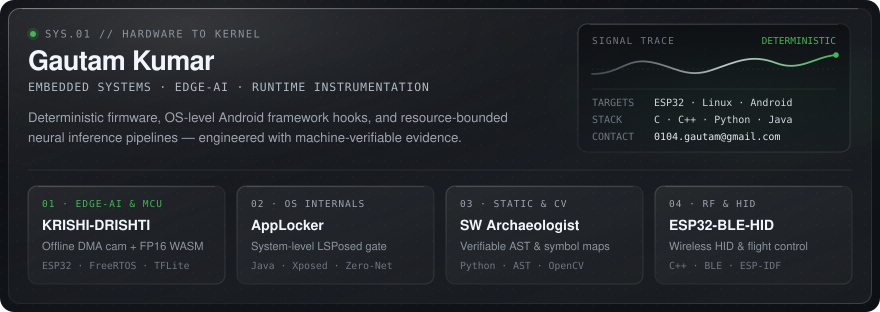
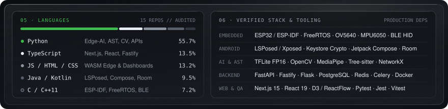
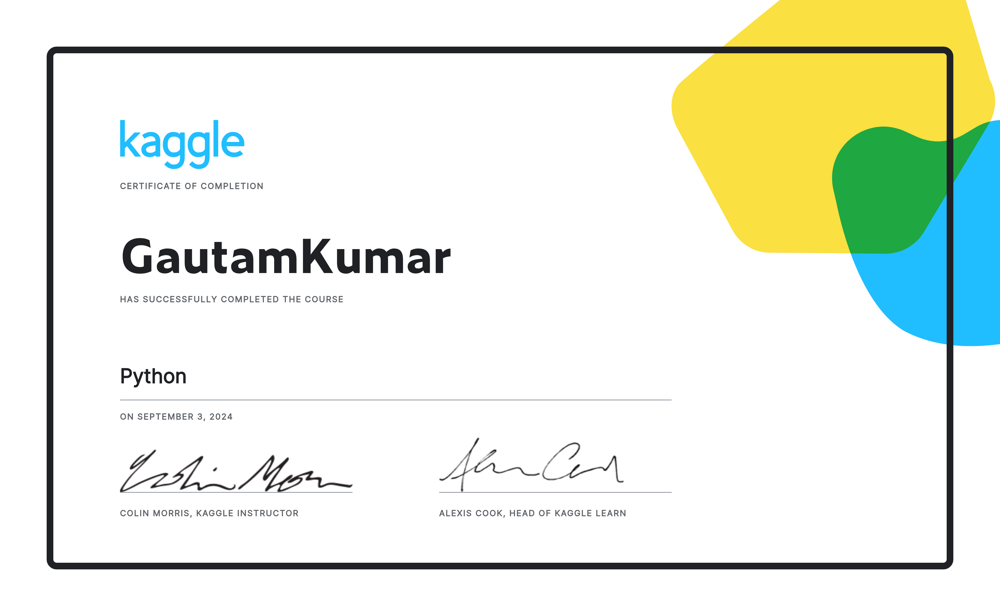

<picture>
  <source media="(prefers-color-scheme: dark)" srcset="./assets/gh_profile_dark.svg">
  <source media="(prefers-color-scheme: light)" srcset="./assets/gh_profile_light.svg">
  
</picture>

 

<picture>
  <source media="(prefers-color-scheme: dark)" srcset="./assets/gh_stack_dark.svg">
  <source media="(prefers-color-scheme: light)" srcset="./assets/gh_stack_light.svg">
  
</picture>

 

  <a href="mailto:0104.gautam@gmail.com">
    <picture>
      <source media="(prefers-color-scheme: dark)" srcset="./assets/contact_email_dark.svg">
      <source media="(prefers-color-scheme: light)" srcset="./assets/contact_email_light.svg">
      
    </picture>
  </a>&nbsp;
  <a href="https://instagram.com/gautam_kumar_0104">
    <picture>
      <source media="(prefers-color-scheme: dark)" srcset="./assets/contact_ig_dark.svg">
      <source media="(prefers-color-scheme: light)" srcset="./assets/contact_ig_light.svg">
      
    </picture>
  </a>&nbsp;
  <a href="https://github.com/gautamkr0104?tab=repositories">
    <picture>
      <source media="(prefers-color-scheme: dark)" srcset="./assets/contact_gh_dark.svg">
      <source media="(prefers-color-scheme: light)" srcset="./assets/contact_gh_light.svg">
      
    </picture>
  </a>&nbsp;
  <a href="https://github.com/gautamkr0104">
    <picture>
      <source media="(prefers-color-scheme: dark)" srcset="./assets/contact_loc_dark.svg">
      <source media="(prefers-color-scheme: light)" srcset="./assets/contact_loc_light.svg">
      
    </picture>
  </a>

  <a href="https://github.com/gautamkr0104/KRISHI-DRISHTI"><code>KRISHI-DRISHTI</code></a> ·
  <a href="https://github.com/gautamkr0104/AppLocker"><code>AppLocker</code></a> ·
  <a href="https://github.com/gautamkr0104/autonomous-software-archaeologist"><code>Archaeologist</code></a> ·
  <a href="https://github.com/gautamkr0104/visionguard"><code>VisionGuard</code></a> ·
  <a href="https://github.com/gautamkr0104/ESP32-BLE-HID"><code>ESP32-BLE-HID</code></a>
   
  <i>"Measure first; ship deterministic state."</i>

<picture>
  <source media="(prefers-color-scheme: dark)" srcset="./assets/gautam_matrix_dark.svg">
  <source media="(prefers-color-scheme: light)" srcset="./assets/gautam_matrix_light.svg">
  
</picture>

 

<b>CERTIFICATION — KAGGLE PYTHON (SEP 2024)</b>
  

